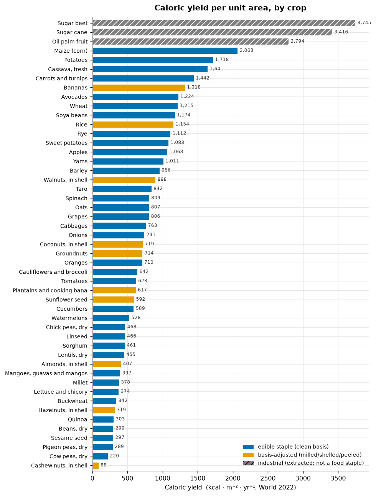
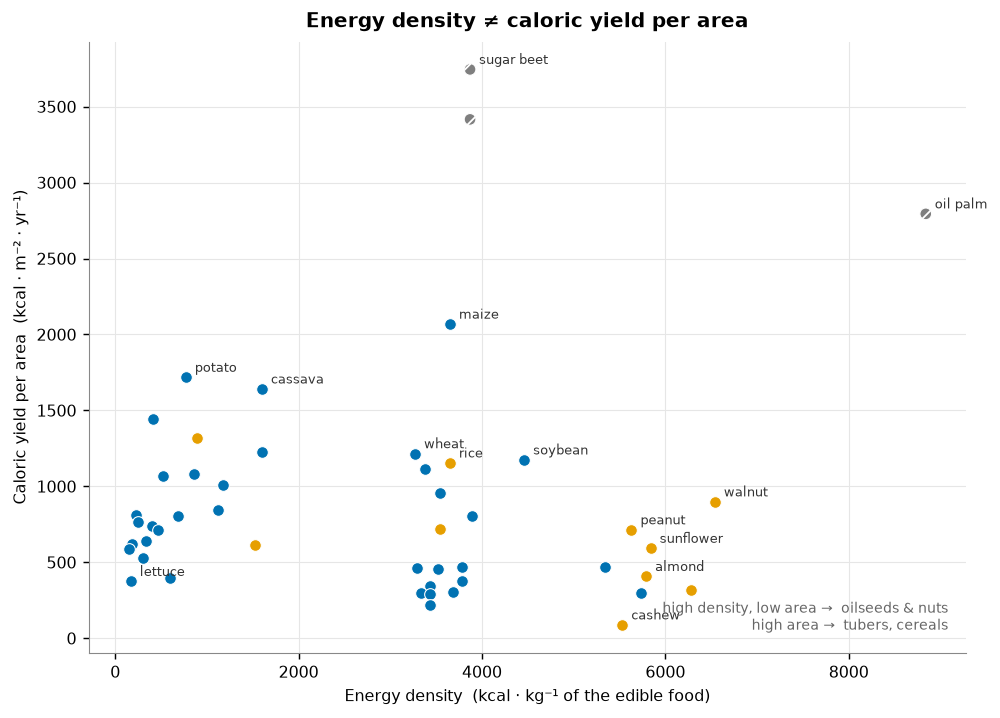
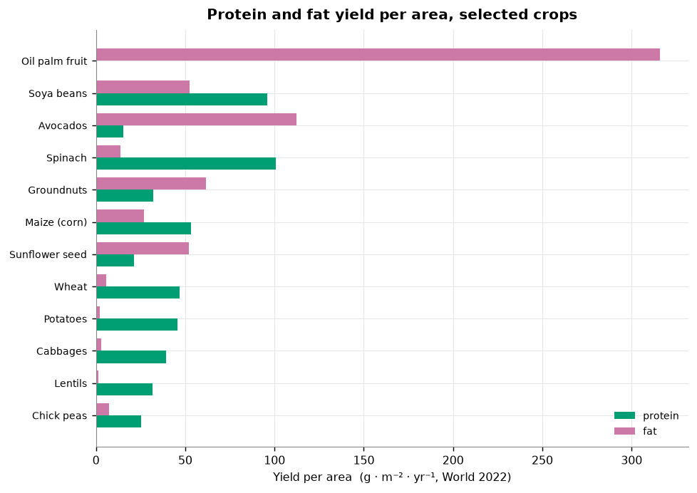

# Caloric-yield-per-area analysis (nutrition section)

**Purpose.** Ground the nutrition section's "area bound" from primary data instead of a blog:
which crops are most calorie-dense per unit area, what their caloric (and protein/fat) yield
per m²/yr is, and the per-kg-vs-per-area distinction. Questions **Q3** (crop set for nutritional
self-sufficiency) and the **CEA-viability filter** are deliberately deferred (see TODOs).

**Reproduce.** `../build_db.py` → `food_data.duckdb`; then `compute_caloric_yield.py`
(→ `results_caloric_yield.csv`) and `make_figures.py` (→ `figures/`). Uses the repo `.venv`.

---

## 1. Data & method

| Source | Role | Licence |
|---|---|---|
| FAOSTAT QCL (Crops & livestock products), World, 2022 | crop **yield** (kg/ha, fresh field weight) | CC BY 4.0 + FAO non-commercial ([`../data/PROVENANCE.md`](../data/PROVENANCE.md)) |
| USDA FoodData Central, SR Legacy 2018 | **energy + macro** densities (per 100 g) | US-Gov public domain |

**Join.** No shared key, so a hand-built crosswalk (`compute_caloric_yield.py::CROSSWALK`) maps
each FAOSTAT item to one USDA `fdc_id`. Energy = `nutrient_id 1008` (kcal); protein 1003, fat 1004.
USDA amounts are per 100 g of the food **as described** (fresh/as-is weight, verified: raw potato =
79 g water/100 g), dimensionally compatible with FAOSTAT fresh yields.

```
kcal · m⁻² · yr⁻¹ = FAOSTAT_yield(kg/ha) × conv_factor × USDA_kcal(per 100 g) / 1000
```
(same formula for protein/fat in g·m⁻²·yr⁻¹).

**Basis classification (the crux).** FAOSTAT reports the whole primary crop; USDA is often a
milled/shelled/extracted fraction. Each crop is tagged and, where needed, multiplied by a
`conv_factor`:

- **clean** (conv = 1.0): whole crop ≈ USDA raw — tubers, most cereals-as-grain, pulses-as-dry-seed,
  fresh vegetables, sesame/flax (eaten whole).
- **basis-adjusted** (conv < 1, flagged): rice (paddy→milled ≈0.67), bananas/plantains (peel ≈0.65),
  groundnuts & tree nuts (in-shell→kernel ≈0.25–0.70), sunflower (seed→kernel ≈0.55), some
  fruit (peel/pit refuse).
- **industrial** (flagged, not a food staple / not CEA): sugar cane & beet (→ sugar ≈0.12–0.16),
  oil palm (→ palm oil ≈0.22).

⚠ **Conversion factors are standard commodity-extraction estimates, not yet cited to a source**
(see TODO). ⚠ **Refuse/edible fraction is NOT in the USDA data** (SR dropped it; FF's is orphaned
and animal-only), so "clean" crops with real peel/refuse (banana handled; orange/watermelon/avocado
given rough factors) are approximate. Numbers are **directional**, robust to ±10–20%.

**Two yield references per crop:** *World 2022 average* and *top-yield* = best national yield among
countries harvesting > 50,000 ha (a realistic large-scale ceiling, not a tiny-plot outlier; verified,
e.g. potato → USA 49 t/ha, sugarcane → Egypt 111 t/ha).

---

## 2. Q1 — Top calorie-dense crops (data-driven ranking)



- **Industrial crops top the ranking** (sugar beet 3,745, sugar cane 3,416, oil palm 2,794 kcal·m⁻²·yr⁻¹
  at World average; higher at top yield). They are the highest-calorie-per-area crops on record — and
  flagged, because they are extracted commodities, not dietary staples, and not CEA candidates.
- **Among edible staples the leaders are cereals and tubers:** maize 2,068, potato 1,718, cassava 1,641,
  then carrots 1,442, banana 1,318, wheat 1,215, soybean 1,174, rice 1,154. The honest band is
  **~1,150–2,100 kcal·m⁻²·yr⁻¹, top three ~1,600–2,100** (only maize/potato/cassava clear 1,500).
  Earlier drafts said "~1,500–2,000"; that overstates the floor.
- At **top-yield**, the best staples roughly double: maize 4,170, potato 3,779, cassava 5,780.
- ⚠ **These are OPEN-FIELD yields.** The crops that top the ranking are broad-acre commodities
  (sugar, oil palm, maize, cassava, wheat) that are not grown in greenhouses; the CEA-viable crops
  (tomato 623, cucumber 589, lettuce 374) sit near the **bottom** of the field ranking, and their
  field numbers *understate* their CEA potential (field tomato ~90 t/ha vs Dutch greenhouse
  ~450–500 t/ha). So this ranking answers *"field caloric yield per area,"* not *"CEA yield."*

## 3. Q2 — Caloric yield per area, and the per-kg-vs-per-area distinction



**The key result for the section.** Energy density (per kg) and caloric yield (per area) are
**not the same axis**, and the crops that win on one lose on the other:

| | highest energy **density** (kcal/kg) | highest caloric **yield per area** (kcal/m²/yr) |
|---|---|---|
| leaders | oil palm 8,840, walnut 6,540, peanut 5,630, sunflower 5,840 | sugar/oil (industrial); then maize 2,068, potato 1,718, cassava 1,641 |
| the point | oilseeds & nuts | tubers & cereals |

Walnuts are the densest true food (6,540 kcal/kg) yet yield only 898 kcal·m⁻²·yr⁻¹; soybean is
4,460 kcal/kg but 1,174 per area; peanut 5,630 kcal/kg but 714 per area. **So energy-dense crops do
not shrink the land requirement — they complement bulk-calorie tubers/cereals on density and
storability, exactly the section's claim.**

**Area bound (derived) — an OPEN-FIELD baseline, not a CEA figure.** At 2,000 kcal/day (≈730,000
kcal/yr; FAO/WHO/UNU adult requirement is actually 2,000–2,900 depending on weight/activity), full
caloric self-sufficiency from the best *field* staple needs ≈ **350–425 m²/adult at World-average
yields** (maize 353, potato 425), falling to ≈ **175–195 m²/adult at top field yields**.

⚠ **This is the open-field land cost of calories — the "area pole" of the area-vs-energy tradeoff at
zero energy input, i.e. the baseline CEA is measured against — NOT the greenhouse footprint the
system needs.** It must not enter the paper as a CEA-system requirement. A CEA area bound is a
different computation (CEA yields for the CEA-viable subset, plus the stacking/energy lever) and is
deferred with Q3. What this number legitimately grounds is the section's *physics floor*: on a single
sunlit plane, calories per m² are capped, and full calories take hundreds of m² — which is exactly why
compressing that footprint requires either land or the energy the section discusses.

### Protein & fat per area


- **Fat per area:** oil palm dominates (316 g·m⁻²·yr⁻¹); among foods, avocado (112), walnut (90),
  coconut (68), groundnut (62), soybean (53), sunflower (52).
- **Protein per area:** soybean (96) leads the storable crops; leafy greens look high (spinach 100,
  cauliflower/broccoli 53, maize 53) — ⚠ **interpret with care:** leafy-green protein-per-area is high
  only because fresh tonnage is huge and ~90% water; it is not storable and not comparable to
  soybean's dry-seed protein without a moisture/storability caveat.

---

## 4. Caveats (carry into the paper)

0. **These are OPEN-FIELD yields, not CEA yields** (the one that must not be misread). The ranking and
   the ~200–470 m²/adult area bound are the *field* land cost of calories — the baseline CEA is
   measured against — not the greenhouse footprint the system needs. CEA-viable crops rank low here and
   their field numbers understate CEA potential. Label accordingly in the paper.
1. **Conversion factors** (milling/shelling/extraction/peel) are standard estimates, **not yet
   sourced** — verify against FAO Technical Conversion Factors before any number is quoted in the paper.
2. **No edible/refuse data** in USDA FDC → "clean" crops with real refuse are approximate.
3. **Single year (2022), World aggregate.** Trends and regional spread not yet explored.
4. **Crosswalk is one USDA entry per crop** (a representative variety), not a weighted average.
5. FAOSTAT **"Rice" = paddy**; milled-rice conversion applied (0.67).

## 5. TODO (separate efforts)

- **Q3 — crop set for nutritional self-sufficiency.** Needs a *nutrient-requirement* source
  (RDA/DRI — in neither FAOSTAT nor USDA) plus an optimization (set-cover / LP over USDA's full
  nutrient profile × per-area yield). Not a query; a modeling task.
- **CEA-viability filter.** Which of these crops are actually greenhouse-viable is a domain-knowledge
  layer (evidence tiers), deliberately not applied here. Merits its own discussion.
- **Source the conversion factors; add an external refuse table** (FAO/INFOODS) for edible yield.

---

## 6. Adversarial verification

An independent adversarial pass reproduced the pipeline from the raw database and tried to break it.

**Survived (verified correct):**
- **Arithmetic is exact** — independent recompute of potato (1,718), maize (2,068), soybean (1,174),
  walnut (898), oil palm (2,794) from raw FAOSTAT/USDA values all match the CSV.
- **Source values reproduce exactly** (every spot-checked USDA + FAOSTAT figure).
- **Item semantics correct:** Rice = paddy (0.67 milling justified); Groundnuts/tree-nuts genuinely
  in-shell → kernel conv justified; Maize = dry field grain (365 kcal), **not** sweet corn.
- **Hull treatment internally consistent** (hulled rice/barley/oats get conv<1; free-threshing
  maize/wheat/rye/sorghum get 1.0). **Top-yield filter robust** (no micro-plot anomalies).
- **Density ≠ area is robust;** protein-per-area water/storability caveat handled honestly.

**Fixes applied from the pass:**
- Wheat crosswalk `durum → hard red winter` (durum overstated wheat protein ~10–25%; kcal moved <3%,
  now 1,215 with protein 46.8 g·m⁻²·yr⁻¹).
- Convergence restated **~1,150–2,100** (top three ~1,600–2,100), not "~1,500–2,000".
- Method's potato-water figure corrected 83 → 79 g/100 g (the exact food used, fdc 170026).
- **Area bound relabeled as an open-field baseline, not a CEA figure** (the one material finding; §3).

**Left as flagged TODOs:** conversion factors uncited (coconut 0.35 / oil-palm 0.22 shakiest, both
non-staple and excluded); no refuse conv on cassava peel / some fresh veg (directional only).

## 7. Is this useful for the research? What do the results mean for the project?

**Useful — yes, as a primary-data replacement for the blog-sourced number.** The pipeline is
reproducible, the arithmetic is exact, the sources are authoritative (FAOSTAT + USDA), and the
section's actual thesis point — energy density ≠ caloric yield per area — is now *demonstrated from
data* rather than asserted. The honest caveats travel with it. That is real, on-mission value, and
the reproducible crosswalk (agronomic yield joined to nutrient density) is a good seed artifact for
the shared data-commons thesis.

**But be precise about what it means for THIS project** (open, decentralized, adaptable CEA; hybrid
daylight+stacked; food independence as a per-user area-vs-energy tradeoff):

- The ranking is **field caloric yield per area, not CEA yield.** Its top crops (sugar, oil palm,
  maize, cassava, wheat) are exactly the ones the system will *not* grow; the CEA-viable crops
  (tomato, cucumber, lettuce, greens) sit near the bottom, where field yield *understates* their CEA
  potential. So the analysis is most useful as **(a) the baseline/denominator** — the open-field land
  cost of calories, the thing CEA is measured against — and **(b) a clean teaching of the density≠area
  axis.** It is *not yet* a statement about the system's own per-user footprint.
- It **serves the area-vs-energy framing well** by quantifying the *area pole* from primary data:
  field staples buy cheap calories per m² with zero stacking and zero energy input; CEA spends energy
  to compress area and to grow the low-density, high-value crops at the bottom of this table. The
  *energy pole* and the CEA-yield uplift are the missing half — correctly parked in the TODOs (with Q3).
- **The one thing that must not enter the paper unqualified** is the "~200–470 m²/adult" area bound
  presented as if it characterizes the CEA system. It characterizes open-field staple production and
  is now labeled as the conservative field baseline CEA is trying to beat. With that label, it
  legitimately grounds the section's *physics floor* (single sunlit plane → hundreds of m² for full
  calories → compression needs land or energy).

**Bottom line:** trustworthy and reproducible at the computation level; the numbers are right. Use it
as the field baseline and the density≠area demonstration; do not read the area figure as a CEA result.
